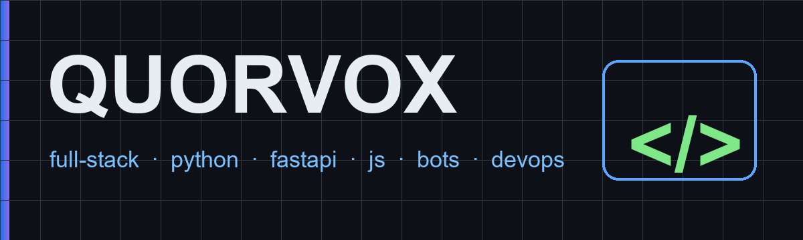

  

  

  
  
  

---

### Обо мне

Full-stack разработчик и дизайнер, команда **Quorvox**. Делаю веб-сервисы, ботов и инструменты под Все системы: от лендинга за вечер до API с Postgres и CI. Код аккуратный, комменты по делу.

### Стек

  

### Проекты

**Легкие примеры** — полный отчет обо всех действиях:

| Проект | Что внутри |
|---|---|
| [p1-aqa-shop](https://github.com/Quorvox/p1-aqa-shop) | магазин-API + 28 автотестов |
| [p2-fastapi-orders](https://github.com/Quorvox/p2-fastapi-orders) | FastAPI + JWT + Alembic + 12 тестов |
| [p3-llm-agent](https://github.com/Quorvox/p3-llm-agent) | RAG-агент + tools + k8s, 11 тестов |
| [p4-devops-nginx](https://github.com/Quorvox/p4-devops-nginx) | nginx + compose + CI, живой чек |
| [p5-nlp-toxic](https://github.com/Quorvox/p5-nlp-toxic) | токсичность RU, f1 0.957 |

**Web-серия:**

| Проект | Демо |
|---|---|
| [w1-peregovory-gantt](https://github.com/Quorvox/w1-peregovory-gantt) | [открыть](https://quorvox.github.io/w1-peregovory-gantt/) |
| [w2-nanobloger](https://github.com/Quorvox/w2-nanobloger) | [открыть](https://quorvox.github.io/w2-nanobloger/) |
| [w3-faq-api](https://github.com/Quorvox/w3-faq-api) | [открыть](https://quorvox.github.io/w3-faq-api/) |

**Копии больших проектов:** [PlacePlay](https://github.com/Quorvox/PlacePlay) (CS2-платформа) · [VPNSait](https://github.com/Quorvox/VPNSait) · [animesait](https://github.com/Quorvox/animesait) · [game-optimizer](https://github.com/Quorvox/game-optimizer)

### Статистика

  
  

### Змейка

  <picture>
    <source media="(prefers-color-scheme: dark)" srcset="https://raw.githubusercontent.com/Quorvox/Quorvox/output/github-snake-dark.svg"/>
    
  </picture>

